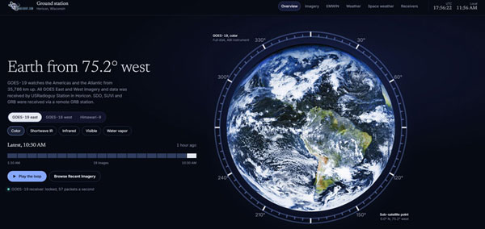
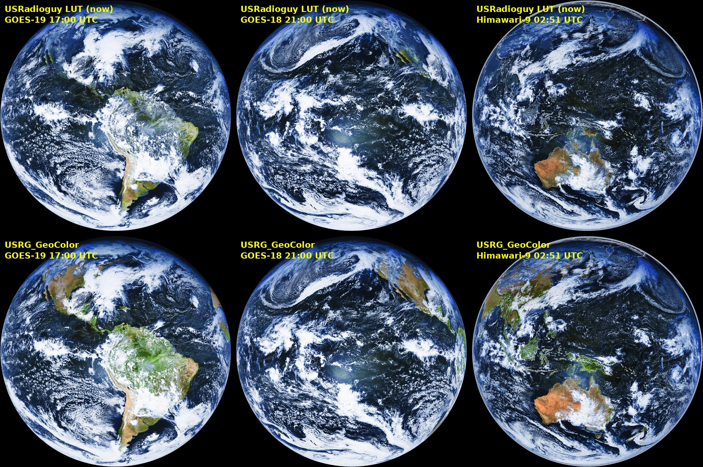
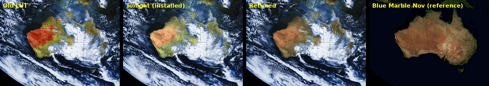
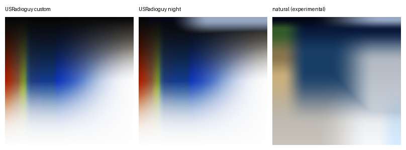

# goestools: USRadioguy edition

This is the [USRadioguy](https://usradioguy.com) fork of
[pietern/goestools](https://github.com/pietern/goestools). It runs the
two-receiver ground station in Horicon, Wisconsin: GOES-19 (East) and
GOES-18 (West, which also relays Himawari-9), each on its own
Raspberry Pi.


Everything here is a drop-in replacement for upstream goestools. Your
existing `goesrecv.conf` and `goesproc-goesr.conf` keep working.


*Top row: GOES-19, current output on the left, night LUT on the right.
Bottom row: Himawari-9, first attempt on the left, calibrated version
on the right. All received in Horicon on 23 Nov 2026.*

---

## What's new

### USRG_GeoColor: natural Earth colors (new, 26 Nov 2026)


HRIT carries only one visible band (red), so a classic false color LUT
has to guess land colors from brightness and temperature. It often
paints land like ocean, deserts red, or the whole US green in November.
**USRG_GeoColor** fixes the land:

* A fixed **land mask** for each satellite (Natural Earth coastlines)
  says exactly which pixels are land.
* On land, the color comes from **NASA's Blue Marble Next Generation**
  for the time of year. goesproc blends the two nearest months by date,
  so November eases into December, and the Southern Hemisphere gets its
  own season automatically.
* **All brightness is still live** from the visible channel. Shadows,
  haze and day/night are real. Very bright land (snow, salt flats) fades
  to white.
* **Clouds, ocean and the night side** keep the LUT's colors, so the
  weather looks exactly as before.
* Works for **GOES-19, GOES-18 and Himawari-9**, full disk only.
  Mesoscale images keep the LUT colors.

Add it to any 2-channel false color handler:

```toml
  [handler.lut]
  path = "/usr/share/goestools/usradioguy/usradioguy_lut.png"

  [handler.geocolor]
  path = "/usr/share/goestools/usradioguy/geocolor"
  satellite = "goes19"     # goes19, goes18 or himawari9
  strength = 1.0           # 1.0 = Blue Marble colors as they are
```

The data (land masks plus 12 monthly tints per satellite, 4.7 MB) is
installed with goestools. Rebuild it with
`scripts/make_geocolor_data.py`. In the Horicon station configs,
USRG_GeoColor replaces the USRadioguy LUT product: images go to
`fd/USRG_GeoColor/` and are named `..._USRG_GeoColor_...`. It adds a few
seconds per full disk on a Pi 4 and needs about 150 MB of free memory
while it runs.

Blue Marble imagery: NASA Earth Observatory, Reto Stöckli (public domain).

### USRG_GeoFusion: GeoColor plus cold cloud tops (new, 27 Nov 2026)


**USRG_GeoFusion** is USRG_GeoColor with the enhanced Channel 13 colors
laid on top. Everything grey in the enhancement (cloud warmer than about
-20 C, clear sky, map lines) is left out, so you see natural Earth colors
plus the colored cold cloud tops of storms. The colors go on at 75%, so
the cloud texture underneath still shows. Small gaps in the color (dark
steps in the color scale, map lines crossing a storm) are filled so
storms stay solid.

* **GOES-19 and GOES-18:** the colors come from the file's own
  calibration and the same `[handler.gradient.ch13]` as your
  `ch13_enhanced` images.
* **Himawari-9:** the relay carries no calibration, so the colors come
  from a table measured from a GOES-18 Channel 13 pair
  (`himawari9_geofusion_table.png`, made by
  `scripts/make_geofusion_tables.py`).
* **New: Himawari-9 IR Enhanced** (`fd/ir_enhanced/`, `..._IRENH_...`),
  the same Channel 13 style colors for the relayed infrared image.

Add it to a USRG_GeoColor handler (it writes a GeoFusion image instead
of the plain GeoColor one, so use a copy of that handler):

```toml
  [handler.geofusion]
  strength = 0.75          # 1.0 = enhancement colors fully opaque

  # GOES: the Channel 13 colors
  [handler.gradient.ch13]
  points = [ ... same as your ch13_enhanced handler ... ]

  # Himawari-9 instead of a gradient:
  # table = "/usr/share/goestools/usradioguy/himawari9_geofusion_table.png"
```

Images go to `fd/USRG_GeoFusion/`, named `..._USRG_GeoFusion_...`.
At night GeoColor is dark, so GeoFusion shows the cold cloud tops over
a black Earth. It adds about one second per full disk.

### Builds on today's systems
* Works with CMake 3.10 through **CMake 4.x**. The original no longer
  configures on CMake 4.
* Works with GCC 8 through 13, OpenCV 3 and 4, and PROJ 5 through 9.
  Tested on Ubuntu 24.04 (x86-64) and on Raspbian 10 "Buster" (armhf,
  Raspberry Pi).
* The libaec submodule now points at its GitHub mirror, because the old
  `gitlab.dkrz.de` address often fails to clone.
* **`make install` no longer overwrites your live config.** The example
  configs are installed as `goesproc-goesr.conf.example`, so a
  `goesproc-goesr.conf` you keep in `share/goestools/` is left alone.

### Bug fixes
* **Map overlays:** `map_drawer.cc` failed to compile whenever PROJ was
  installed. Fixed. GeoJSON `Point`, `MultiPoint` and `MultiLineString`
  features now draw correctly, for example a ground-station marker.
* **Himawari timestamps:** Himawari image times were off by your UTC
  offset on any machine whose clock isn't set to UTC. They now use true
  UTC.
* **Himawari folders:** the example configs now save each Himawari
  channel in its own folder, the same way GOES does:
  `himawari9/fd/vs/<date>/`, `fd/ir/<date>/`, `fd/wv/<date>/` (before,
  all three went into `himawari9/fd/<date>/`). In your own config,
  change the raw Himawari handler's line to
  `directory = "./himawari9/{region:short|lower}/{channel:short|lower}/{time:%Y-%m-%d}"`.

### Himawari-9 false color
The Himawari handler (`origin = "himawari8"`) now supports the same
options as the GOES-R handler:

```toml
[[handler]]
type = "image"
origin = "himawari8"
channels = [ "vs", "ir" ]          # band names work too: [ "b03", "b13" ]
directory = "./himawari9/{region:short|lower}/fc/{time:%Y-%m-%d}"
filename = "Himawari9_{region:short}_FC_{time:%Y%m%dT%H%M%SZ}"
format = "jpg"

  [handler.remap.vs]                 # visible: brighten to GOES ch02 level
  path = "/usr/share/goestools/usradioguy/himawari9_vs_curve.png"

  [handler.remap.ir]                 # infrared: convert to the GOES ch13 scale
  path = "/usr/share/goestools/usradioguy/himawari9_ir_curve.png"

  [handler.lut]
  path = "/usr/share/goestools/usradioguy/usradioguy_night_lut.png"
```

Why the two curves are needed: the Himawari images relayed over
GOES-West HRIT use different brightness scales than GOES ABI.
* **Visible:** Himawari VS is about 2.6 times darker than GOES ch02.
* **Infrared:** Himawari IR puts warm land at counts of about 14–26,
  where GOES ch13 uses 45–50.

Without the curves, any LUT made for GOES turns Himawari's land orange
or red and its day side murky. The curves were calibrated on real
imagery from both satellites.

**Natural land colors (Himawari LUT).** The USRadioguy LUTs color the
hottest land (the warmest infrared) deep red. GOES-19 rarely sees land
that hot. Himawari-9 looks straight at the Australian outback, whose
surface tops 330 K around midday, so the whole continent turned deep
orange-red. `himawari9_night_lut.png` is the same night LUT with only
the land colors repainted, hottest first: red ochre/rust, rust-brown,
brown-tan, then dry grass. Ocean, cloud and night colors are unchanged.
The first version (25 Nov) came out peach at Australian noon; on 26 Nov
it was retuned against NASA Blue Marble's outback color. Make your own
from any LUT with `scripts/make_himawari_lut.py`. With USRG_GeoColor
turned on, this LUT does Himawari's ocean, clouds and night side, and
USRG_GeoColor does the land.



Other Himawari changes:
* The handler now **obeys a `channels` filter** (older versions ignored it).
* Space outside the disk stays black in false color instead of being
  drawn as cold cloud.

### Himawari-9 enhanced water vapor
The Himawari handler now supports `[handler.gradient.<channel>]`, the
same Kelvin-based color enhancement used for GOES (for example ch08 and
ch09). Each relayed Himawari image carries a calibration table, the
LRIT image data function, for example
`0:=330.00 1:=302.72 253:=193.58 254:=0.00`. Himawari lists only a few
anchor points, so the levels between them are interpolated, and levels
marked 0 K (off-disk) stay black.

The relayed water vapor image is Himawari **band 8 (6.2 µm)**, the same
upper-level band as GOES ch08, so a ch08 gradient fits it directly:

```toml
[[handler]]
type = "image"
origin = "himawari8"
channels = [ "wv" ]           # also "b08" or "ir3"
directory = "./himawari9/{region:short|lower}/wv_enhanced/{time:%Y-%m-%d}"
filename = "Himawari9_{region:short}_WVENH_{time:%Y%m%dT%H%M%SZ}"
format = "jpg"

  [handler.gradient.wv]
  points = [
    { units = 276, color = "#000000" },
    { units = 275.9, color = "#ff0000" },
    { units = 258, color = "#ffff00" },
    { units = 250, color = "#000070" },
    { units = 233, color = "#ffffff" },
    { units = 195, color = "#408020" },
    { units = 188, color = "#00ffff" }
  ]
```
Gradients work on the `ir` channel as well. For example,
`[handler.gradient.ir]` takes the same points as a GOES ch13 enhancement.

### False color lookup tables


Installed in `share/goestools/usradioguy/`:

| File | What it is |
|---|---|
| `usradioguy_lut.png` | The [USRadioguy custom LUT](https://usradioguy.com/custom-color-lookup-table/) |
| `usradioguy_night_lut.png` | Same daytime colors, but cloud tops stay visible in blue-grey on the night side instead of going black |
| `usradioguy_natural_lut.png` | Experimental, built from scratch |
| `himawari9_vs_curve.png` | Himawari visible curve (see above) |
| `himawari9_ir_curve.png` | Himawari infrared curve (see above) |
| `himawari9_night_lut.png` | Night LUT with natural Himawari land colors (see below). Retuned 26 Nov 2026 to rust-brown outback (was peach at noon) |
| `himawari9_lut.png` | Day-only version of the same |
| `geocolor/` | USRG_GeoColor data: land masks, monthly Blue Marble tints, luminance |

Each one can be regenerated or tuned with a script in `scripts/`:

| Script | Makes |
|---|---|
| `make_night_lut.py BASE.png OUT.png` | Adds a night side to **any** LUT |
| `make_himawari_vs_curve.py WXSTAR_CURVE.png OUT.png [GAIN]` | The Himawari visible curve |
| `calibrate_himawari_ir.py OUT.png --goes ... --himawari ...` | Recalibrates the Himawari IR curve from your own images |
| `make_natural_lut.py [OUT.png]` | The experimental natural LUT |
| `make_geocolor_data.py BLUE_MARBLE_DIR OUT_DIR` | The USRG_GeoColor data, from NASA's 12 monthly Blue Marble images |

The scripts need Python 3 with `numpy` and `Pillow`.

### Example configs
`share/usradioguy/examples/` holds the configs the Horicon station
actually runs:
* `goesproc-goesr-goes19-east.conf` for the GOES-19 receiver.
* `goesproc-goesr-goes18-west.conf` for the GOES-18 receiver, which
  includes Himawari-9.

Some paths in them are specific to that station, for example
`/home/pi/goes/...` LUTs and `/home/pi/groundstation.json`. Adjust
them to your own setup before use.

---

## The complete ground station
Want the whole station, not just goestools? The companion
[USRadioguy GOESTOOLS Ground Station](https://github.com/creinemann/USRadioguy_GOESTOOLS_Groundstation)
package installs this goestools on a Raspberry Pi with one script.
It also sets up a website you can open from any browser on your
network. Step-by-step guide:
[Installing USRadioguy goestools on a Raspberry Pi](https://usradioguy.com/installing-usradioguy-goestools-on-a-raspberry-pi/).


*The Lab view: the latest image from each satellite, a 24-hour
timeline, loop playback and live receiver status.*


*The Ground Station HUD: live signal lock, Viterbi errors, packet
rate, an event log, and the receiver Pi's CPU, temperature, memory and
disk.*

## Install or upgrade

### New install
```sh
git clone --recursive https://github.com/creinemann/goestools
cd goestools && mkdir build && cd build
cmake .. -DCMAKE_INSTALL_PREFIX=/usr/local -DCMAKE_BUILD_TYPE=Release
make -j2
sudo make install
```

### Upgrading an existing Raspberry Pi receiver
See **[docs/guides/usradioguy_pi_upgrade.md](docs/guides/usradioguy_pi_upgrade.md)**
for a step-by-step guide. It covers backups, Buster, PuTTY,
receivers started from `rc.local` inside `screen`, and rollback. Your
receiver keeps running during the build, and the switch-over takes only
a few seconds.

**Use the same install prefix as your current install.** Check with
`which goesrecv`:
* `/usr/bin/goesrecv` means `-DCMAKE_INSTALL_PREFIX=/usr`.
* `/usr/local/bin/goesrecv` means `-DCMAKE_INSTALL_PREFIX=/usr/local`.

Otherwise you end up with two copies, and your startup scripts keep
running the old one.

---

## Updating

New features and fixes land here regularly. First, find which kind of
install you have:

| You installed with… | Follow |
|---|---|
| The **USRadioguy GOESTOOLS Ground Station** installer (`install.sh`, project in `/opt/groundstation`) | **A** |
| **This goestools**, built yourself with `git clone` + `cmake` | **B** |
| The **original** goestools (pietern), or a very old build | **C** |

Not sure? Run `ls /opt/groundstation`. If the folder exists, it's **A**.
Otherwise, run `ls -d ~/goestools*` to find your build folder, then
`git -C <that folder> remote -v`. If it shows `creinemann/goestools`,
it's **B**.

### A. Ground Station installs: one command
```sh
cd /opt/groundstation && git pull && ./install.sh
```
Press **Enter** at each question. It remembers your answers from last
time. The installer downloads and builds the newest goestools, updates
the website, and restarts everything. **Your settings are kept.** When a
config file has changed, the new version is saved next to yours with
`.new` on the end so you can compare.

### B. goestools you built yourself: 4 steps
Your receiver keeps running while it builds, about 10–15 minutes on a Pi 4.

**1. Get the new code.** Go to the folder you built in. If you followed
the Pi upgrade guide, that's `~/goestools-usradioguy`; otherwise it's
usually `~/goestools`:
```sh
cd ~/goestools-usradioguy        # or: cd ~/goestools
git fetch origin
git checkout main                # early installs were on "usradioguy-modernize"
git pull
git submodule update --init --recursive
```

**2. Build it:**
```sh
cd build
make -j2
```
Wait for the prompt to come back. The last lines should end at `[100%]`
with no `Error`.

**3. Install it:**
```sh
sudo make install
```
This uses the same install location as before (`/usr` or `/usr/local`).
It **never overwrites your `goesproc-goesr.conf`**. New example configs
are saved as `.example` files, and new color tables (LUTs) and curves
are added to `share/goestools/usradioguy/`.

**4. Restart goestools** so the new version runs:
* Started by **systemd** (`systemctl status goesrecv` shows it):
  `sudo systemctl restart goesrecv goesproc`
* Started from **`/etc/rc.local`** or **`screen`**: `sudo reboot`

**Check it worked:**
```sh
goesproc --version
ps aux | grep -E "goes(recv|proc)" | grep -v grep
```
You should see one `goesrecv` and one `goesproc` running. Imagery
continues with the next scan.

**New features may need a config change.** An update adds new
abilities, but your own `goesproc-goesr.conf` stays as you left it. To
use something new (for example the Himawari color table), see what's
new above and compare your config with the example in
`share/goestools/usradioguy/examples/`.

### C. Coming from the original goestools
Follow the **[Pi upgrade guide](docs/guides/usradioguy_pi_upgrade.md)**.
It covers backups, matching your install location, `rc.local`/`screen`
setups, and how to roll back.

### If something goes wrong
* **Build error:** in your build folder, run `cd build && cmake .. && make -j2` and
  check the last 20 lines. Your old goestools is still installed and
  still running, because nothing changes until `sudo make install`.
* **Two copies installed:** `which -a goesrecv` lists more than one when
  the old and new versions use different locations. See "Use the same
  install prefix" above.
* Questions? Open an issue on GitHub or ask on
  [usradioguy.com](https://usradioguy.com).

---

## Credits
goestools was written by Pieter Noordhuis and contributors. The
USRadioguy changes are by Carl Reinemann
([usradioguy.com](https://usradioguy.com)).
