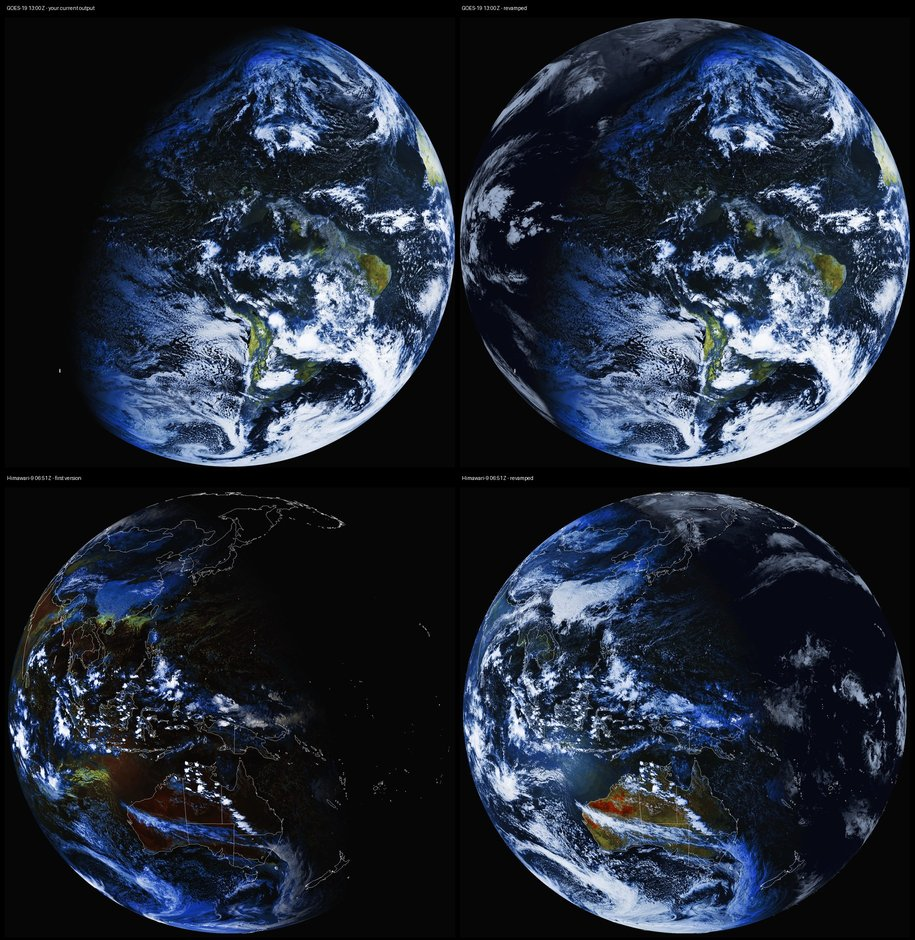

# goestools: USRadioguy edition

This is the [USRadioguy](https://usradioguy.com) fork of
[pietern/goestools](https://github.com/pietern/goestools). It runs the
two-receiver ground station in Horicon, Wisconsin: GOES-19 (East) and
GOES-18 (West, which also relays Himawari-9), each on its own
Raspberry Pi.

Everything here is a drop-in replacement for upstream goestools. Your
existing `goesrecv.conf` and `goesproc-goesr.conf` keep working.



*Top row: GOES-19, current output on the left, night LUT on the right.
Bottom row: Himawari-9, first attempt on the left, calibrated version
on the right. All received in Horicon on 23 Nov 2026.*

---

## What's new

### Builds on today's systems
* Works with CMake 3.10 through **CMake 4.x**. The original no longer
  configures on CMake 4.
* Works with GCC 8 through 13, OpenCV 3 and 4, and PROJ 5 through 9.
  Tested on Ubuntu 24.04 (x86-64) and on Raspbian 10 "Buster" (armhf,
  Raspberry Pi).
* The libaec submodule now points at its GitHub mirror, because the old
  `gitlab.dkrz.de` address often fails to clone.
* **`make install` no longer overwrites your live config.** The example
  configs are installed as `goesproc-goesr.conf.example`, so a
  `goesproc-goesr.conf` you keep in `share/goestools/` is left alone.

### Bug fixes
* **Map overlays:** `map_drawer.cc` failed to compile whenever PROJ was
  installed. Fixed. GeoJSON `Point`, `MultiPoint` and `MultiLineString`
  features now draw correctly, for example a ground-station marker.
* **Himawari timestamps:** Himawari image times were off by your UTC
  offset on any machine whose clock isn't set to UTC. They now use true
  UTC.

### Himawari-9 false color
The Himawari handler (`origin = "himawari8"`) now supports the same
options as the GOES-R handler:

```toml
[[handler]]
type = "image"
origin = "himawari8"
channels = [ "vs", "ir" ]          # band names work too: [ "b03", "b13" ]
directory = "./himawari9/{region:short|lower}/fc/{time:%Y-%m-%d}"
filename = "Himawari9_{region:short}_FC_{time:%Y%m%dT%H%M%SZ}"
format = "jpg"

  [handler.remap.vs]                 # visible: brighten to GOES ch02 level
  path = "/usr/share/goestools/usradioguy/himawari9_vs_curve.png"

  [handler.remap.ir]                 # infrared: convert to the GOES ch13 scale
  path = "/usr/share/goestools/usradioguy/himawari9_ir_curve.png"

  [handler.lut]
  path = "/usr/share/goestools/usradioguy/usradioguy_night_lut.png"
```

Why the two curves are needed: the Himawari images relayed over
GOES-West HRIT use different brightness scales than GOES ABI.
* **Visible:** Himawari VS is about 2.6 times darker than GOES ch02.
* **Infrared:** Himawari IR puts warm land at counts of about 14–26,
  where GOES ch13 uses 45–50.

Without the curves, any LUT made for GOES turns Himawari's land orange
or red and its day side murky. The curves were calibrated on real
imagery from both satellites.

Other Himawari changes:
* The handler now **obeys a `channels` filter** (older versions ignored it).
* Space outside the disk stays black in false color instead of being
  drawn as cold cloud.

### False color lookup tables


Installed in `share/goestools/usradioguy/`:

| File | What it is |
|---|---|
| `usradioguy_lut.png` | The [USRadioguy custom LUT](https://usradioguy.com/custom-color-lookup-table/) |
| `usradioguy_night_lut.png` | Same daytime colors, but cloud tops stay visible in blue-grey on the night side instead of going black |
| `usradioguy_natural_lut.png` | Experimental, built from scratch |
| `himawari9_vs_curve.png` | Himawari visible curve (see above) |
| `himawari9_ir_curve.png` | Himawari infrared curve (see above) |

Each one can be regenerated or tuned with a script in `scripts/`:

| Script | Makes |
|---|---|
| `make_night_lut.py BASE.png OUT.png` | Adds a night side to **any** LUT |
| `make_himawari_vs_curve.py WXSTAR_CURVE.png OUT.png [GAIN]` | The Himawari visible curve |
| `calibrate_himawari_ir.py OUT.png --goes ... --himawari ...` | Recalibrates the Himawari IR curve from your own images |
| `make_natural_lut.py [OUT.png]` | The experimental natural LUT |

The scripts need Python 3 with `numpy` and `Pillow`.

### Example configs
`share/usradioguy/examples/` holds the configs the Horicon station
actually runs:
* `goesproc-goesr-goes19-east.conf` for the GOES-19 receiver.
* `goesproc-goesr-goes18-west.conf` for the GOES-18 receiver, which
  includes Himawari-9.

Some paths in them are specific to that station, for example
`/home/pi/goes/...` LUTs and `/home/pi/groundstation.json`. Adjust
them to your own setup before use.

---

## Install or upgrade

### New install
```sh
git clone --recursive https://github.com/creinemann/goestools
cd goestools && mkdir build && cd build
cmake .. -DCMAKE_INSTALL_PREFIX=/usr/local -DCMAKE_BUILD_TYPE=Release
make -j2
sudo make install
```

### Upgrading an existing Raspberry Pi receiver
See **[docs/guides/usradioguy_pi_upgrade.md](docs/guides/usradioguy_pi_upgrade.md)**
for a step-by-step guide. It covers backups, Buster, PuTTY,
receivers started from `rc.local` inside `screen`, and rollback. Your
receiver keeps running during the build, and the switch-over takes only
a few seconds.

**Use the same install prefix as your current install.** Check with
`which goesrecv`:
* `/usr/bin/goesrecv` means `-DCMAKE_INSTALL_PREFIX=/usr`.
* `/usr/local/bin/goesrecv` means `-DCMAKE_INSTALL_PREFIX=/usr/local`.

Otherwise you end up with two copies, and your startup scripts keep
running the old one.

---

## Credits
goestools was written by Pieter Noordhuis and contributors. The
USRadioguy changes are by Carl Reinemann
([usradioguy.com](https://usradioguy.com)).
